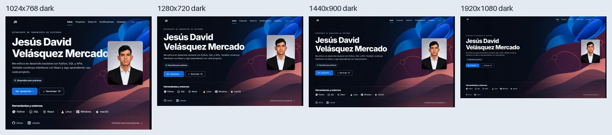

# E7-01: auditoría visual y métricas base

Revisión local del **21 de noviembre de 2026**, correspondiente a
[E7-01 / #61](https://github.com/Jesus-engineer/My-Resume-Web/issues/61).
Rama: `desarrollador`. Fuente auditada: `99b3446e5c5d70b798608472ced659002650a18f`.

Actualización posterior del 2026-11-21: el dueño pidió conservar únicamente el
diseño oscuro original. Este informe conserva la línea base histórica de ambos
temas; los hallazgos del modo claro ya no describen una variante disponible.
El comando de auditoría actual guarda las ocho pantallas oscuras en
`artifacts/ui/actual/`, separado de las capturas originales de esta revisión.

El hero no cabe en la primera vista de las dos pantallas de escritorio más
pequeñas. En 1024 px, además, el apellido se superpone con la foto. En móvil el
principal problema es la densidad: la página mide 8390 px en 360 × 800.
Además, Contacto pierde legibilidad en tema claro móvil, con muestras de
contraste de apenas 1.08:1. Los ajustes deben empezar por Hero/cabecera (#63)
y la legibilidad de Contacto (#65), y aplicar un ancho de contenido común
antes de retocar las otras secciones.

## Evidencia y reproducción

- [Métricas completas por pantalla y tema](metricas.json).
- [Galería local de las 152 capturas originales y 30 resúmenes](../../../artifacts/ui/e7-01/index.html).
- [Script reproducible](../../../scripts/audit_ui.py).
- [Dependencias opcionales fijadas](../../../scripts/requirements-ui.txt).

Las capturas originales ocupan aproximadamente 95 MB y se guardan en
`artifacts/ui/e7-01/`, ignorado por Git. La galería se abre directamente en el
navegador después de ejecutar la auditoría. Los resúmenes seleccionados de
`imagenes/` y las métricas acompañan este informe para conservar evidencia
compacta en el repositorio; las auditorías del estado actual se generan localmente.

```bash
python -m pip install -r scripts/requirements-ui.txt
python -m playwright install chromium
python scripts/audit_ui.py
```

El script inicia y apaga su propio servidor HTTP en `127.0.0.1` y un puerto
libre. No requiere modificar `index.html`, levantar un servidor aparte ni añadir
un paso de build al sitio. Para conservar otra ejecución:

```bash
python scripts/audit_ui.py --output artifacts/ui/e7-01-comparacion
```

Entorno de esta medición: Python 3.12, Playwright 1.64.1, Chromium 156.0.8078.4,
Pillow 12.2.0 y DPR 1. Se esperó la carga de fuentes e imágenes y se usó
`prefers-reduced-motion: reduce` para obtener capturas estables, con emulación
móvil/táctil en los cuatro anchos de teléfono. El tema se cambió mediante el
control visible del sitio. Las medidas de la superposición del título se
comprobaron también con rangos de texto del DOM.

Esta línea base corresponde a HTTP local y emulación de Chromium. No sustituye
la comprobación en un teléfono físico ni las mediciones de Lighthouse en
producción de #67/#68. El muestreo de contraste siguiente cubre textos
seleccionados de Contacto, no toda la página. El contraste y la impresión
A4 se deberán volver a medir al implementar los ajustes.

## Cobertura de #61

- [x] Página completa y cinco secciones en 1024 × 768, 1280 × 720,
  1440 × 900, 1920 × 1080, 320 × 568, 360 × 800, 390 × 844 y 430 × 932,
  con temas oscuro y claro.
- [x] Menú móvil abierto en las ocho combinaciones de teléfono/tema y visor
  abierto en las 16 combinaciones.
- [x] Métricas del pliegue del hero, anchos, alturas de tarjetas, fuentes y
  áreas interactivas.
- [x] Lista priorizada de ajustes para #63 a #67, con alcance de escritorio y
  móvil.

Las 152 capturas se distribuyen en 16 páginas completas, 80 secciones, 16 pies,
16 primeras vistas, 16 visores y 8 menús. Los 30 resúmenes adicionales agrupan
las cuatro pantallas por sección, tema y tipo de dispositivo.

## Alturas base

Píxeles CSS, redondeados. Los dos temas produjeron las mismas alturas en las
cinco secciones para cada tamaño; las cifras originales con decimales están en
`metricas.json`. El total incluye el pie.

| Pantalla | Hero | Proyectos | Sobre mí | Certificaciones | Contacto | Total |
| --- | ---: | ---: | ---: | ---: | ---: | ---: |
| 1024 × 768 | 797 | 1524 | 1147 | 840 | 600 | 4984 |
| 1280 × 720 | 786 | 1163 | 1191 | 757 | 552 | 4525 |
| 1440 × 900 | 900 | 1202 | 1228 | 820 | 732 | 4960 |
| 1920 × 1080 | 1080 | 1259 | 1254 | 1000 | 912 | 5582 |
| 320 × 568 | 1358 | 2493 | 2100 | 1894 | 927 | 8911 |
| 360 × 800 | 1299 | 2282 | 2029 | 1718 | 924 | 8390 |
| 390 × 844 | 1251 | 2162 | 2000 | 1677 | 924 | 8153 |
| 430 × 932 | 1267 | 2122 | 1886 | 1527 | 900 | 7839 |

En 1024 × 768 faltan aproximadamente 29 px para contener todo el hero; en
1280 × 720 faltan 66 px. En 1440 y 1920 sí cabe en una pantalla. La reducción
mínima del 20 % solicitada por #63 implica pasar de 1299.11 a **1039.29 px o
menos** en 360 × 800, conservando el contenido esencial.



En 1024 px, el rango de texto de «Velásquez Mercado» llega a `x = 722.67`,
mientras la foto comienza en `x = 714.92`: hay **7.75 px de superposición** en
ambos temas. La ausencia de scroll horizontal no detecta esta colisión; la
regla `white-space: nowrap` del título debe revisarse en #63.

[Hero móvil y posición actual de la foto](imagenes/movil-dark-inicio.webp).

## Anchos y ritmo de las grillas

Ancho exterior de los contenedores, en píxeles CSS. Hero/Proyectos/Sobre mí
comparten ancho; Finder y Contacto/pie usan márgenes distintos.

| Pantalla | Hero / Proyectos / Sobre mí | Finder | Contacto / pie |
| --- | ---: | ---: | ---: |
| 1024 | 916.84 | 849.28 | 865.66 |
| 1280 | 1149.81 | 1065.34 | 1085.81 |
| 1440 | 1295.41 | 1168.00 | 1223.41 |
| 1920 | 1761.00 | 1168.00 | 1681.00 |
| 360 | 320.00 | 320.00 | 320.00 |

En 1920 px la diferencia entre Proyectos y Finder es de **593 px**. Las
columnas de Proyectos llegan a 587 px cada una. En 1024 px hay dos tarjetas de
475.63 px de alto y una tercera de 375.05 px, sola en la segunda fila.

Las tarjetas de certificaciones sí se igualan dentro de cada fila por el
comportamiento de Grid, pero el ritmo entre filas cambia: en 1440 px pasan de
160 a 218.66 px; en 1280 px, de 176.06 a 218.66 px. El ajuste de #66 debe
centrarse en ese ritmo y en la alineación del contenido, sin asumir que cada
tarjeta de una misma fila tiene una altura distinta.

[Grilla de proyectos](imagenes/escritorio-dark-proyectos.webp) ·
[Finder en tema claro](imagenes/escritorio-light-certificaciones.webp).

## Legibilidad, objetivos y visor

| Elemento | Medición | Acción asociada |
| --- | --- | --- |
| Texto de maquetas decorativas | 8.32–11.2 px en los tamaños revisados | #64: simplificar maquetas en móvil y revisar su lectura en escritorio. Están bajo `aria-hidden`; no son contenido operativo. |
| Filtros en teléfonos | 12 px de fuente; 44 px de alto | #66: subir a ≥ 13 px conservando el área táctil. En 320 px el tercer filtro salta de fila. |
| Skip link enfocado | 183.61 × 39.09 px, contorno visible | #63: alcanzar la altura objetivo del proyecto de 44 px. |
| Enlace «Inicio», escritorio | 37.06 × 44 px | #63: ampliar el ancho clicable. |
| Marca del pie, escritorio | 21.13 × 44 px | #65: ampliar el área clicable sin cambiar la marca. |
| Visor en 360 × 800 | Diálogo de 328 × 389.11 px; imagen de 227.11 px de alto | #66: aprovechar mejor el viewport y añadir navegación entre certificados. |

Los 44 px son el objetivo de comodidad de las issues del proyecto; esta tabla
no clasifica automáticamente como infracción WCAG cada objetivo menor.

[Orden de Sobre mí en móvil](imagenes/movil-dark-sobre-mi.webp) ·
[Visor actual en móvil](imagenes/movil-dark-visor-abierto.webp) ·
[Contacto en tema claro](imagenes/movil-light-contacto.webp).

## Hallazgo de prioridad alta: Contacto en tema claro móvil

En los cuatro teléfonos, el texto blanco queda sobre el velo claro del fondo.
El muestreo confirma el problema que muestran las capturas:

| Texto en 360 × 800 | Tema oscuro | Tema claro | Umbral usado |
| --- | ---: | ---: | ---: |
| ¿Hablamos? | 18.73–18.75:1 | 2.15–2.25:1 | 3:1, título grande |
| Introducción | 16.73–16.75:1 | 1.76–1.88:1 | 4.5:1 |
| Escríbeme directamente | 14.81–14.92:1 | 1.28–1.29:1 | 4.5:1 |
| Conoce mi perfil profesional | 14.81–14.92:1 | 1.17–1.19:1 | 4.5:1 |
| Explora mis repositorios | 14.68–14.87:1 | 1.08–1.10:1 | 4.5:1 |

Se muestrearon nueve puntos del fondo dentro del rango de cada texto,
ocultando temporalmente `.contacto__grid` con `visibility: hidden` para
conservar su geometría. Se comparó el fondo renderizado con el color sRGB
computado del texto; coordenadas, RGB y ratios están en `contactContrast`
de cada medición. La cuadrícula se restaura tras la captura de diagnóstico.

El problema se reproduce en los cuatro anchos móviles del tema claro. Las
muestras de escritorio y de móvil oscuro superan los umbrales usados.
La regla de tema claro dentro de `@media (max-width: 1023px)` aclara el
pseudo-elemento del fondo, mientras Contacto conserva colores de texto
blancos fijos. #65 debe resolver esa combinación antes de los retoques de
composición; por eso se recomienda adelantarla respecto de su prioridad
media actual en GitHub.

## Comportamiento comprobado

- Cero desbordes horizontales en las 16 combinaciones; esto no descarta la
  superposición del título descrita arriba.
- Cero errores de consola/JavaScript y cero solicitudes fallidas o HTTP ≥ 400
  durante las capturas y las interacciones locales.
- Los filtros muestran 6 certificados en Todos, 2 en Programación y 4 en
  Datos e IA, en los 16 casos, con actualización del texto de estado.
- El menú móvil anuncia su apertura, enfoca el primer enlace y cierra con
  Escape devolviendo el foco al botón, en los ocho casos móviles.
- El visor abre la imagen real, enfoca Cerrar y conserva el ciclo de Tab y
  Shift+Tab. Escape devuelve el foco al enlace de origen y el backdrop cierra
  el diálogo, en las 16 combinaciones.
- ArrowRight no cambia el certificado: la navegación pedida en #66 está
  pendiente de implementar.
- `pnpm.cmd run validate:html` termina sin errores para `index.html` y
  `deck/index.html`.

## Orden de implementación

| Orden | Issue | Escritorio | Móvil |
| --- | --- | --- | --- |
| 1 | [#63 · Hero y cabecera](https://github.com/Jesus-engineer/My-Resume-Web/issues/63) | Resolver el apellido sobre la foto en 1024, contener el hero en 1024/1280, definir el ancho común y ampliar áreas de enlaces. | Integrar foto, disponibilidad y CTA arriba; reducir el hero a ≤ 1039.29 px en 360 × 800, compactar herramientas y revisar el menú con motion reducido. |
| 2 | [#65 · Sobre mí, Contacto y pie](https://github.com/Jesus-engineer/My-Resume-Web/issues/65) | Alinear los contenedores, equilibrar texto/arte y ajustar la proporción de Contacto en las tres alturas de escritorio. | Resolver primero el contraste de Contacto en tema claro; después mostrar la historia antes de la ilustración y revisar chips a ancho completo y los 176 px de padding inferior. |
| 3 | [#64 · Proyectos](https://github.com/Jesus-engineer/My-Resume-Web/issues/64) | Aplicar el ancho común, resolver la tarjeta huérfana de 1024 y mejorar el detalle técnico con datos reales. | Reducir los 2281.55 px de la sección en 360, simplificar las maquetas pequeñas y conservar completa la portada real de SIPIIT. |
| 4 | [#66 · Finder y visor](https://github.com/Jesus-engineer/My-Resume-Web/issues/66) | Regular el ritmo entre filas, alinear el Finder, comprobar contraste de separadores y añadir Anterior/Siguiente con el filtro activo. | Mejorar densidad, subir filtros a ≥ 13 px y aprovechar mejor el visor, conservando Tab, Escape y retorno de foco. |
| 5 | [#67 · Rendimiento](https://github.com/Jesus-engineer/My-Resume-Web/issues/67) | Consolidar breakpoints y perfilar lecturas geométricas/SVG después de estabilizar la composición. | Evaluar entrega de imágenes y coste de SVG/scroll con perfil móvil; medir, sin asumir que recomprimir aporta una mejora. |

El inventario medido para #67 es: `styles.css` 60416 bytes, `app.js` 11960,
foto 26718 (480 × 480), portada SIPIIT 40828 (1280 × 476), fondo de
certificaciones 26764 y de contacto 22454 (ambos 1536 × 1024). Los breakpoints
1100, 1023, 767 y 460 aparecen dos veces cada uno en la hoja de estilos.
`actualizarSeccionActual()` lee la geometría de la cabecera y las cinco
secciones al actualizar la navegación; su coste y los posibles reflows
requieren perfilado, no se han cuantificado en esta auditoría.

Después corresponde #68: QA conjunta, dispositivos reales, A4, deck, CI y
Lighthouse en producción. #62 puede trabajar la traducción en paralelo al
orden visual anterior, conservando la paridad de contenido y la descarga del
CV en cada idioma. Este informe deja cubierta la auditoría local de #61; el
estado de la issue en GitHub no se modifica.
