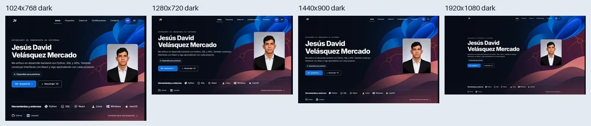

# E7-03: hero y cabecera en escritorio y móvil

Implementación local de [#63](https://github.com/Jesus-engineer/My-Resume-Web/issues/63),
verificada el 2026-11-21 en la rama `desarrollador`, para español e inglés.

## Criterios comprobados

- [x] Hero completo dentro de la primera pantalla en 1024 × 768 y 1280 × 720,
  incluidos foto, acciones, herramientas y pie. También cabe en 1440 × 900 y
  1920 × 1080. El contenido conserva su altura natural y no se recorta para
  cumplir esta condición.
- [x] Contenedor de cabecera y hero de hasta 1280 px, centrado desde 1440 px.
  Título adaptable al ancho y alto disponibles, sin colisión con el retrato.
- [x] Navegación con áreas de al menos 44 × 44 px, fondo visible en hover/foco
  y estado activo con acento de sección. El skip link mide 44 px de alto.
- [x] Desplazamiento uniforme: 72 px de cabecera más 16 px de separación.
  Las cuatro secciones posteriores al inicio quedan a `y = 88 px`; el inicio
  vuelve a `y = 0` y su contenido incorpora ese espacio superior.
- [x] Foto junto a la presentación en móvil, disponibilidad y dos acciones
  debajo. En 360 × 800 ambos botones son visibles en la primera pantalla.
  La altura española baja de 1299.11 a 850.08 px: **34.56 % menos**, por encima
  del mínimo del 20 %. La inglesa baja de 1279.31 a 844.06 px: **34.02 % menos**.
- [x] Menú móvil separado de la barra, con fondo oscuro sólido, animación breve
  y scroll interno cuando falta altura. Respeta `prefers-reduced-motion`.
- [x] `pnpm run validate:html` pasa para ES, EN y el deck; `node --check app.js`
  pasa. Se mantienen las rutas estáticas y el funcionamiento desde archivo.

Se conservan el diseño oscuro, las ondas de color y el contenido de ambas
versiones. El mínimo de 44 px también se aplica al enlace de marca del pie y
al filtro inglés «All», que quedaba por debajo en pantallas estrechas.

## Medidas del hero

Píxeles CSS, DPR 1. La columna anterior procede de E7-01 para español y de la
auditoría de E7-02 para inglés. Los valores actuales corresponden al mismo
conjunto de pantallas; los cuatro teléfonos utilizan emulación móvil y táctil.

| Pantalla | ES anterior | ES actual | EN anterior | EN actual |
| --- | ---: | ---: | ---: | ---: |
| 1024 × 768 | 797.05 | 768 | 797.05 | 768 |
| 1280 × 720 | 785.50 | 720 | 785.50 | 720 |
| 1440 × 900 | 900 | 900 | 900 | 900 |
| 1920 × 1080 | 1080 | 1080 | 1080 | 1080 |
| 320 × 568 | 1358.30 | 878.91 | 1338.50 | 859.11 |
| 360 × 800 | 1299.11 | 850.08 | 1279.31 | 844.06 |
| 390 × 844 | 1251.13 | 842.14 | 1251.13 | 816.55 |
| 430 × 932 | 1266.97 | 832.91 | 1237.28 | 832.91 |

En escritorio, el pie termina a 16 px del borde inferior de la pantalla. El
ancho del contenido es 916.84 px en 1024, 1149.81 px en 1280 y 1280 px en las
otras dos pantallas. No hay desborde horizontal ni controles medidos por debajo
de 44 × 44 px en las 16 capturas.



[Hero en los cuatro teléfonos](imagenes/movil.webp) ·
[Menú móvil en inglés](imagenes/menu-en.webp) ·
[Métricas compactas](metricas.json).

## Navegación, teclado y alternativas

Además de las 16 auditorías visuales, se revisaron ambos idiomas en 460, 461,
767, 768 y 1023 px. Los 26 casos de geometría y navegación comprueban ausencia
de desborde, título dentro de su columna, separación entre título y foto,
objetivos mínimos, las cinco anclas, actualización del enlace activo y
activación del skip link con Enter.

Se probaron ocho casos de menú: ES/EN, 360 × 800 o 568 × 320 y movimiento normal
o reducido. Todos verifican foco inicial en Inicio/Home, Escape y retorno al
botón, salida con Tab sin perder el foco del primer CTA, cierre al pulsar fuera
y al pasar a escritorio. En la pantalla horizontal, los idiomas siguen siendo
alcanzables mediante scroll dentro del menú. La animación es `abrirMenu`
en movimiento normal y `none` con movimiento reducido.

Otros seis casos comprueban navegación y selector de idioma sin JavaScript en
320 y 1440 px, apertura de ambos HTML mediante `file://` y estilos de impresión
que muestran el contenido y ocultan cabecera y acciones. Las auditorías visuales
también recorren filtros y visor: recuentos 6 / 2 / 4, cierre, ciclo de foco y
retorno al enlace de origen. No se registran errores de consola ni peticiones
fallidas en el uso normal de los 16 casos.

## Reproducción y alcance

Con las dependencias opcionales descritas en el README:

```bash
python scripts/audit_ui.py --lang es --output artifacts/ui/e7-03-es
python scripts/audit_ui.py --lang en --output artifacts/ui/e7-03-en
pnpm run validate:html
node --check app.js
```

Las 152 capturas originales, galerías y métricas completas quedan en
`artifacts/ui/e7-03-es/` y `artifacts/ui/e7-03-en/`, ignorados por Git.
`artifacts/ui/e7-03/verificacion.json` conserva la comprobación adicional de
26 pantallas, ocho menús y seis alternativas. Los resúmenes de `imagenes/` y
las métricas compactas acompañan este informe en el repositorio.

Entorno: Chromium 156.0.8078.4, Playwright 1.64.1, Python 3.12.10 y Pillow
12.2.0. Se esperó a fuentes e imágenes; las capturas usan movimiento reducido.
Esta verificación local cubre Chromium y emulación de móvil. La comprobación
en dispositivos físicos y otros navegadores queda para el QA de publicación.
