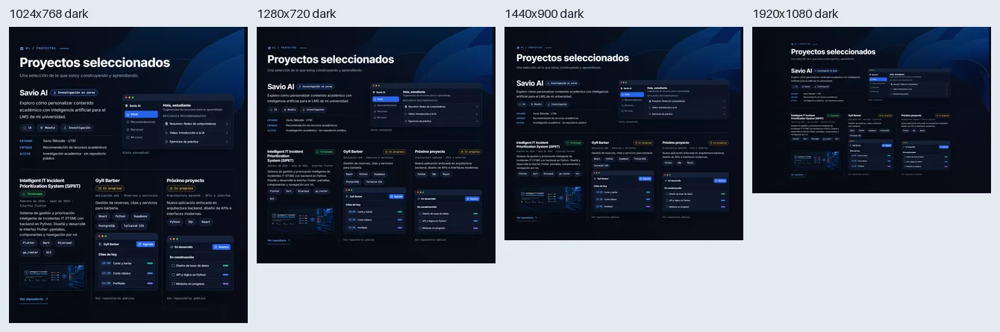

# E7-04: proyectos, grilla y maquetas en escritorio y móvil

Implementación local de [#64](https://github.com/Jesus-engineer/My-Resume-Web/issues/64),
verificada el 2026-11-22 en la rama `desarrollador`, para español e inglés.

## Criterios comprobados

- [x] **Ancho común en escritorio:** `#proyectos` adopta el contenedor compartido
  `--ancho-contenido` (`80rem` / `1280 px`) alineado con cabecera y hero en
  `1440 × 900` y `1920 × 1080` (antes `1295.41 px` y `1761 px`, con columnas de
  `587 px`). Las tres columnas pasan a `426.67 px` en `1440` y `1920 px`.
- [x] **Sin tarjeta huérfana en `1024 px` ni en tablet:** la grilla mantiene
  tres columnas iguales desde `1024 px` (`305.61 × 540.89 px` cada tarjeta;
  altura total de la sección `-16.65 %` en ES y `-18.04 %` en EN). Entre
  `768 px` y `1023 px`, SIPIIT ocupa el ancho completo en composición horizontal
  (texto a la izquierda y portada a la derecha) y las dos tarjetas en progreso
  comparten la segunda fila con igual altura.
- [x] **Detalle técnico real en `Savio AI` y tarjetas:** se añade ficha técnica
  (`Entorno`, `Enfoque`, `Acceso`) y leyenda `Vista conceptual` en `Savio AI`,
  stack verificado (`Riverpod`, `go_router`) y rol (`Interfaz Flutter`) en
  SIPIIT, y metadatos + estado honesto (`Sin repositorio público` /
  `No public repository`) en `GyR Barber` y `Próximo proyecto` sin inventar URLs.
- [x] **Móvil (`<= 767 px`) sin texto `< 12 px` y menor densidad:** se eleva
  toda la tipografía visible de `#proyectos` (badges y maquetas) a `>= 12 px`
  (`0` elementos `< 12 px` en `#proyectos` en las 16 pantallas), se simplifica
  la maqueta de `Savio AI` a una sola columna y se ocultan las dos maquetas
  decorativas secundarias en `<= 767 px`, reduciendo la altura en `360 × 800` de
  `2281.55` a `1809.08 px` (**-20.71 %** en ES; **-20.46 %** en EN).
- [x] **Portada real de SIPIIT (`assets/proyectos/sipiit-portada.webp`):** se
  conserva completa y sin recortes (`aspect-ratio: 1280 / 476`,
  `object-fit: contain`) dentro de un marco oscuro alineado con las tarjetas
  vecinas. Se mantiene el archivo original de `40 828 bytes` (`1280 × 476`) tras
  comprobar que recomprimirlo en WebP solo ahorraría ~3–5 KB a costa de degradar
  el texto pequeño de la gráfica.
- [x] `html-validate` pasa para `index.html`, `en/index.html` y `deck/index.html`;
  `node --check app.js` pasa. Cero errores de consola, cero peticiones fallidas,
  cero desbordes horizontales y cero objetivos interactivos `< 44 × 44 px`.

## Medidas de `#proyectos`

Píxeles CSS, DPR 1. Los valores anteriores proceden de las auditorías de E7-03
(ES y EN). El ligero incremento en `1280`–`1920 px` responde a la ficha técnica
añadida en `Savio AI` y al aumento de legibilidad de las maquetas (`>= 12 px`).

| Pantalla | ES anterior | ES actual | Cambio ES | EN anterior | EN actual | Cambio EN |
| --- | ---: | ---: | ---: | ---: | ---: | ---: |
| 1024 × 768 | 1523.97 | 1270.22 | -16.65 % | 1525.08 | 1250.02 | -18.04 % |
| 1280 × 720 | 1163.02 | 1267.67 | +9.00 % | 1188.09 | 1278.06 | +7.57 % |
| 1440 × 900 | 1202.48 | 1286.52 | +6.99 % | 1202.48 | 1309.77 | +8.92 % |
| 1920 × 1080 | 1259.14 | 1337.14 | +6.19 % | 1259.14 | 1337.14 | +6.19 % |
| 320 × 568 | 2493.38 | 1961.80 | -21.32 % | 2491.55 | 1909.66 | -23.35 % |
| 360 × 800 | 2281.55 | 1809.08 | -20.71 % | 2178.94 | 1733.02 | -20.46 % |
| 390 × 844 | 2162.41 | 1757.28 | -18.74 % | 2132.97 | 1703.92 | -20.12 % |
| 430 × 932 | 2122.14 | 1631.63 | -23.11 % | 2082.66 | 1614.28 | -22.49 % |



[Proyectos en los cuatro teléfonos](imagenes/movil.webp) ·
[Composición en tablet 768 px](imagenes/tablet-768.webp) ·
[Métricas compactas](metricas.json).

## Verificaciones adicionales

Además de las 16 ejecuciones estándar de `scripts/audit_ui.py` (ES y EN), se
comprobaron:

- **Tablet (`768 × 1024`, `900 × 900`, `1023 × 800` en ES y EN):** cero desborde,
  cero textos `< 12 px`, SIPIIT a ancho completo con enlace ajustado a su texto
  (`122.45 px` en `768 px`) y segunda fila equilibrada (`GyR Barber` y
  `Próximo proyecto` con la misma coordenada superior y altura).
- **Impresión A4 (ES y EN):** la ficha técnica de `Savio AI` y el enlace de
  SIPIIT permanecen visibles; maquetas decorativas e imagen promocional se
  ocultan.
- **Sin JavaScript (`360 × 800` en ES y EN):** cero desborde, contenido visible
  (`opacity: 1`) y tres tarjetas renderizadas.

## Reproducción

```bash
python scripts/audit_ui.py --lang es --output artifacts/ui/e7-04-es
python scripts/audit_ui.py --lang en --output artifacts/ui/e7-04-en
pnpm run validate:html
node --check app.js
```

Las capturas completas quedan en `artifacts/ui/e7-04-es/`,
`artifacts/ui/e7-04-en/` y `artifacts/ui/e7-04-extra/` (ignorados por Git).
Los resúmenes de `imagenes/` y `metricas.json` acompañan este informe.
