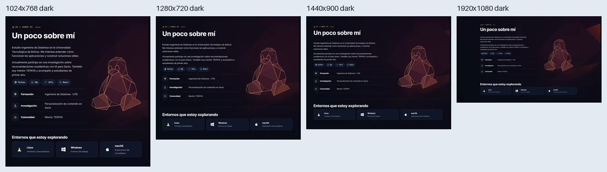

# E7-05: equilibrio de Sobre mí, Contacto y Footer en escritorio y móvil

Implementación local de [#65](https://github.com/Jesus-engineer/My-Resume-Web/issues/65),
verificada el 2026-11-22 en la rama `desarrollador`, para español e inglés.

## Criterios comprobados

- [x] **Ancho compartido en escritorio (`1024–1920 px`):** `#sobre-mi`,
  `#contacto` y `.pie` adoptan `--ancho-contenido` (`80rem` / `1280 px`) y
  `--pad-inline`, alineando exactamente su eje vertical con cabecera, hero y
  proyectos (`916.84 px` en `1024`, `1149.81 px` en `1280` y `1280 px` en
  `1440` y `1920 px`, frente a `1761 px` / `1681 px` anteriores en `1920 px`).
- [x] **Composición balanceada en `#sobre-mi`:** en escritorio, la proporción
  entre narrativa/`.camino` e ilustración del pingüino (`1.2fr / 0.8fr`,
  separador vertical en `.camino dt` y pingüino limitado a `25rem`) elimina el
  hueco central de `1440–1920 px`. En `<= 1023 px`, se retira `order: -1` de
  `.sobre-mi__arte` para mostrar primero título, párrafos, chips compactos y
  `Mi camino` (`aboutArtBeforeText: false` en las 16 pantallas), reduciendo el
  alto en `360 × 800` un **29.02 %** en ES y **29.70 %** en EN.
- [x] **Chips y tipografía sin `< 12 px`:** se elimina el estirado a ancho
  completo de `.chips--grandes .chip` en `<= 460 px` y se sube `.chip__codigo`
  a `0.75rem` (`12 px`), dejando **0 textos `< 12 px`** en todo el sitio en los
  16 viewports ES/EN.
- [x] **Altura y encuadre de `#contacto` y transición a `.pie`:** en escritorio,
  `#contacto` pasa a `min-height: clamp(35rem, 68dvh, 43rem)` con encuadre
  adaptativo del fondo (`center calc(100% + clamp(2.5rem, 4.5vw, 6.5rem))`),
  eliminando el exceso de espacio vacío en `1440 × 900` (`-17.30 %`) y
  `1920 × 1080` (`-25.22 %`) y fundiendo el borde inferior hacia `#0b1525` de
  `.pie`. En móvil (`<= 767 px`), `#contacto` se compacta de `923.94` a
  **`649.45 px`** (**-29.71 %**), cabiendo cómodamente junto al pie en una sola
  pantalla `360 × 800`. En `.pie` móvil, la marca `JV` queda alineada a la
  izquierda con nombre y rol conservando el objetivo `>= 44 × 44 px`.
- [x] **Contraste AA verificado en el diseño oscuro canónico:** todas las
  muestras de `#contacto` superan holgadamente WCAG AA (`4.5:1` / `3:1`) y
  alcanzan `>= 8.85:1` en `1920 × 1080`, `>= 14.08:1` en `1024–1440 px` y
  `14.44:1` en móvil. *(El tema claro fue retirado por decisión del dueño el
  2026-11-21).*
- [x] `html-validate` (`index.html`, `en/index.html`, `deck/index.html`) y
  `node --check app.js` pasan sin errores; 0 desbordes horizontales, 0 errores
  de consola/red y 0 objetivos `< 44 × 44 px`.

## Medidas de `#sobre-mi` y `#contacto`

Píxeles CSS, DPR 1. Comparación frente al estado de E7-04.

| Pantalla | Sobre mí ES | Sobre mí EN | Contacto ES | Contacto EN | Contraste mín. Contacto |
| --- | ---: | ---: | ---: | ---: | ---: |
| 1024 × 768 | 1146.89 → **1067.16** (-6.95 %) | 1110.58 → **1022.75** (-7.91 %) | 608 → **560** (-7.89 %) | 608 → **560** (-7.89 %) | 14.27:1 / 14.32:1 |
| 1280 × 720 | 1190.58 → **1095.31** (-8.00 %) | 1160.89 → **1065.63** (-8.21 %) | 560 → **560** (0.00 %) | 560 → **560** (0.00 %) | 14.13:1 / 14.08:1 |
| 1440 × 900 | 1228.05 → **1127.20** (-8.21 %) | 1198.36 → **1097.52** (-8.41 %) | 740 → **612** (-17.30 %) | 740 → **612** (-17.30 %) | 14.12:1 / 14.12:1 |
| 1920 × 1080 | 1253.67 → **1148.02** (-8.43 %) | 1223.98 → **1118.33** (-8.63 %) | 920 → **688** (-25.22 %) | 920 → **688** (-25.22 %) | 10.00:1 / 8.85:1 |
| 320 × 568 | 2100.28 → **1582.94** (-24.63 %) | 2026.89 → **1466.69** (-27.64 %) | 927.17 → **670.27** (-27.71 %) | 956.86 → **670.27** (-29.95 %) | 14.44:1 / 14.44:1 |
| 360 × 800 | 2029.14 → **1440.30** (-29.02 %) | 1971.41 → **1385.86** (-29.70 %) | 923.94 → **649.45** (-29.71 %) | 923.94 → **649.45** (-29.71 %) | 14.44:1 / 14.44:1 |
| 390 × 844 | 2000.00 → **1414.45** (-29.28 %) | 1884.44 → **1358.27** (-27.92 %) | 923.94 → **649.45** (-29.71 %) | 923.94 → **649.45** (-29.71 %) | 14.44:1 / 14.44:1 |
| 430 × 932 | 1885.77 → **1359.59** (-27.90 %) | 1885.77 → **1333.20** (-29.30 %) | 899.94 → **628.42** (-30.17 %) | 899.94 → **628.42** (-30.17 %) | 14.44:1 / 14.47:1 |



[Sobre mí en móvil](imagenes/movil-sobre-mi.webp) ·
[Contacto en escritorio](imagenes/escritorio-contacto.webp) ·
[Contacto en móvil](imagenes/movil-contacto.webp) ·
[Pie en móvil](imagenes/movil-pie.webp) ·
[Métricas compactas](metricas.json).

## Reproducción

```bash
python scripts/audit_ui.py --lang es --output artifacts/ui/e7-05-es
python scripts/audit_ui.py --lang en --output artifacts/ui/e7-05-en
pnpm run validate:html
node --check app.js
```

Las capturas completas quedan en `artifacts/ui/e7-05-es/` y
`artifacts/ui/e7-05-en/` (ignorados por Git). Los resúmenes de `imagenes/` y
`metricas.json` acompañan este informe.
